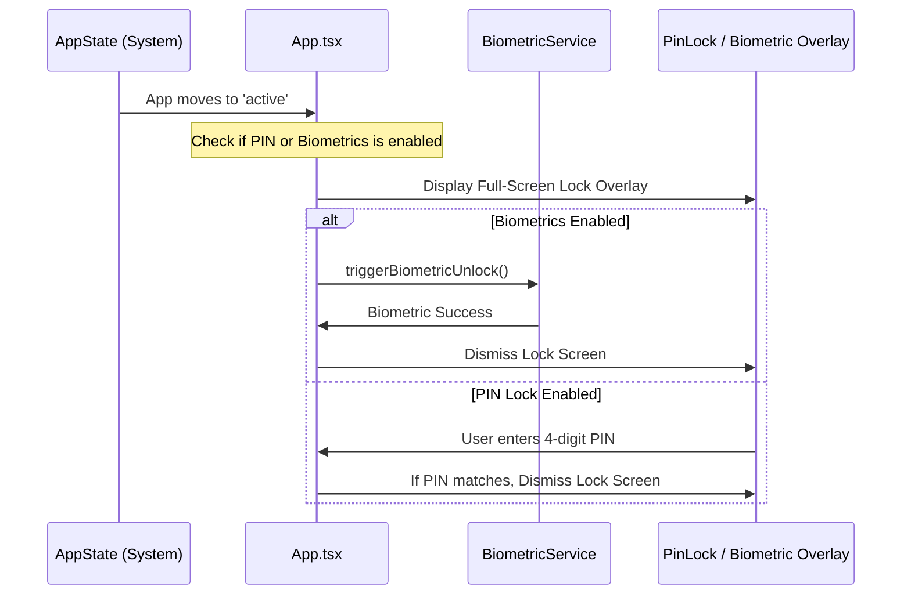

# SERA (Spending & Expense Record App) — Technical Specification & System Architecture

> **Document Status**: Production Ground-Truth Reference  
> **Source Repository**: `com.moneytracker`  
> **Verification Date**: October 2026  
> **Scope**: Exhaustive audit of all existing screens, components, database schemas, state stores, native modules, and workflows implemented in the codebase. Zero speculative or unbuilt features.

---

## 1. Executive Summary & Brand Identity

**SERA** (*Spending & Expense Record App*) is an offline-first, privacy-centric personal financial management application built on React Native. Designed with a cyber-technical and muted editorial visual language, SERA operates entirely on-device without external cloud databases, user tracking, or third-party analytical telemetry.

### Core Architecture Highlights
- **100% Offline Data Sovereignty**: All user records, financial logs, credentials, and settings are stored locally on the device using persistent encrypted storage.
- **Biometric & PIN Defense In Depth**: Hardware-backed biometric authentication (fingerprint/face) via Android `BiometricPrompt` combined with a fallback 4-digit PIN system and automated background app-state locking.
- **System-Level OS Integrations**: Includes 5 native Android home screen widgets, native notification channels with exact alarm scheduling, dynamic Android app launcher shortcuts, and deep linking (`sera://`).
- **Precision Typography & Layout**: Built on dual font stacks—**Inter** for structural headers/labels and **JetBrains Mono** with tabular figure alignments for all balance, ledger, and transaction calculations.

### Brand Design Tokens
- **Emblem**: Geometric boxy "S" emblem split horizontally into two chromatic halves:
  - Upper Half: Titanium Bone (`#E4DFD7`)
  - Lower Half: Vermilion Crimson (`#EB3B2E`)
  - Container: Midnight Obsidian Squircle (`#111822`) with hairline border (`#1F2A38`)
- **Theme Modes**: Supports both Dark Mode (Obsidian midnight `#090E14`) and Light Mode (Paper Bone `#EAEBE6`).

---

## 2. Technical Stack & Dependencies

### Runtime & Toolchain
| Layer | Specification |
| :--- | :--- |
| **Framework** | React Native `0.87.1` / React `19.2.3` |
| **Language** | TypeScript `6.0.3` |
| **JavaScript Engine** | Hermes Engine (`hermesEnabled=true`) |
| **Architecture** | React Native New Architecture (`newArchEnabled=true`) |
| **Target Platform** | Android (minSdkVersion: 24, targetSdkVersion: 35, compileSdkVersion: 35) |
| **JDK Requirement** | OpenJDK 17 (`/opt/homebrew/opt/openjdk@17`) |
| **Build System** | Gradle 9.4.1 / Android Gradle Plugin 9.0 |

### Core Libraries
- **Navigation**: `@react-navigation/native` (`^7.4.1`), `@react-navigation/native-stack` (`^7.19.2`), `@react-navigation/bottom-tabs` (`^7.19.2`)
- **State Management**: `zustand` (`^5.0.15`)
- **Persistence**: `@react-native-async-storage/async-storage` (`^3.1.1`)
- **Hardware & Native**:
  - `androidx.biometric:biometric:1.1.0` (Native Android Biometrics bridge)
  - `react-native-image-picker` (`^8.2.1`) (Camera & Gallery receipt capture)
  - `react-native-safe-area-context` (`^5.5.2`) (Edge-to-edge system insets)
  - `react-native-screens` (`^4.28.0`) (Native view controller optimization)
  - `react-native-svg` (`^15.15.5`) (Vector rendering & charts)
  - `lucide-react-native` (`^1.48.0`) (System iconography)

---

## 3. Design System & Theme Architecture

The visual theme is defined in [`src/theme/`](file:///Users/saksham/Desktop/Projects/moneyTracker/src/theme).

### 3.1 Color Palette

#### Dark Palette (`darkPalette`)
- `background`: `#090E14` (Deep obsidian midnight)
- `surface`: `#111822` (Industrial dark slate container)
- `surfaceLighter`: `#17222F` (Elevated component background)
- `surfaceCard`: `#131C27` (Card backdrop)
- `cardDark`: `#1A2534` / `cardDarker`: `#0D141D`
- `border`: `#1F2A38` / `borderLight`: `#1F2A38` (Hairline technical border)
- `textPrimary`: `#F2F5F8` (High-contrast titanium white)
- `textSecondary`: `#8B97A6` (Muted technical slate)
- `textMuted`: `#586574` (Inactive/faint labels)
- `accent`: `#EB3B2E` / `accentRed`: `#EB3B2E` (Controlled vermilion crimson)
- `positive`: `#34D399` (Mint green for inflows & savings)
- `negative`: `#EB3B2E` (Vermilion crimson for debits & expenses)
- `warning`: `#F59E0B` (Amber warning for budget thresholds)
- `panelBone`: `#E4DFD7` (Warm bone contrast panel)
- `panelBoneText`: `#0A0F15`

#### Light Palette (`lightPalette`)
- `background`: `#EAEBE6` (Warm technical stone)
- `surface`: `#F4F5F1` (Clean ivory surface)
- `surfaceLighter`: `#FFFFFF`
- `surfaceCard`: `#F0F1ED`
- `border`: `rgba(12, 17, 23, 0.14)`
- `textPrimary`: `#0C1117`
- `textSecondary`: `#5C6775`
- `textMuted`: `#7D8895`
- `accent`: `#EB3B2E`
- `positive`: `#10B981`
- `negative`: `#EB3B2E`

### 3.2 Typography Tokens ([`src/theme/typography.ts`](file:///Users/saksham/Desktop/Projects/moneyTracker/src/theme/typography.ts))

SERA utilizes 15 distinct typography variants configured for both iOS and Android:
1. `displayLarge`: 48px, JetBrainsMono-Bold, `tabular-nums`, -1.2 letterSpacing
2. `displayMedium`: 34px, JetBrainsMono-Bold, `tabular-nums`, -0.8 letterSpacing
3. `pageHeading`: 28px, Inter-Bold, -0.4 letterSpacing
4. `pageSubheading`: 20px, Inter-SemiBold, -0.2 letterSpacing
5. `sectionHeading`: 16px, Inter-Bold, uppercase, +0.6 letterSpacing
6. `cardTitle`: 15px, Inter-SemiBold, -0.2 letterSpacing
7. `bodyLarge`: 15px, Inter-Regular, 22px lineHeight
8. `bodyMedium`: 13px, Inter-Regular, 18px lineHeight
9. `metadata`: 11px, JetBrainsMono-Medium, +0.4 letterSpacing
10. `label`: 10px, JetBrainsMono-Bold, uppercase, +1.5 letterSpacing
11. `labelSmall`: 9px, JetBrainsMono-Bold, uppercase, +1.2 letterSpacing
12. `specCode`: 10px, JetBrainsMono-Bold, uppercase, +1.4 letterSpacing
13. `amountLarge`: 32px, JetBrainsMono-Bold, `tabular-nums`, -0.5 letterSpacing
14. `amountMedium`: 20px, JetBrainsMono-Bold, `tabular-nums`
15. `amountSmall`: 14px, JetBrainsMono-Bold, `tabular-nums`

### 3.3 Radii & Spacing ([`src/theme/radius.ts`](file:///Users/saksham/Desktop/Projects/moneyTracker/src/theme/radius.ts))
- `none`: 0
- `xs`: 4 (micro indicators & badges)
- `sm`: 6 (rounded chips, pills, inner controls)
- `md`: 8 (buttons, text inputs, keypad keys)
- `lg`: 12 (primary cards, overview heroes, balance containers)
- `xl`: 16 (dialogs, bottom sheets, modals)
- `full`: 9999 (avatars, circular meters)

---

## 4. Database Schema & Persistence Layer

The database layer ([`src/database/database.ts`](file:///Users/saksham/Desktop/Projects/moneyTracker/src/database/database.ts)) is built on top of versioned `@react-native-async-storage/async-storage` keys with a subscriber notification pattern.

### 4.1 Storage Keys
- `@money_tracker_accounts_v1`: List of user financial accounts.
- `@money_tracker_categories_v1`: Expense and income classification categories.
- `@money_tracker_transactions_v1`: Master transaction ledger.
- `@money_tracker_budget_v1`: Global monthly budget targets.
- `@money_tracker_budget_categories_v1`: Per-category budget limits and spend tracking.
- `@money_tracker_goals_v1`: Target savings goals.
- `@money_tracker_goal_contributions_v1`: Ledger of goal deposits.
- `@money_tracker_subscriptions_v1`: Recurring monthly/annual billing commitments.
- `@money_tracker_recurring_transactions_v1`: Scheduled recurring movements.
- `@money_tracker_settings_v1`: App configuration, security flags, profile data.
- `@money_tracker_initialized_v2`: First-run database initialization flag.

### 4.2 Entity Definitions ([`src/types/index.ts`](file:///Users/saksham/Desktop/Projects/moneyTracker/src/types/index.ts))

#### Account
```typescript
interface Account {
  id: string;
  name: string;
  type: 'bank' | 'cash' | 'credit' | 'debit' | 'wallet' | 'investment' | 'savings' | 'other';
  balance: number;
  currency: string;
  isArchived: boolean;
  institution?: string;
  accountNumberMask?: string;
  createdAt: string;
  updatedAt: string;
}
```

#### Category
```typescript
interface Category {
  id: string;
  name: string;
  icon: string; // Lucide icon identifier
  color: string;
  type: 'expense' | 'income' | 'both';
  isDefault: boolean;
  budgetLimit?: number;
  createdAt: string;
}
```

#### Transaction
```typescript
interface Transaction {
  id: string;
  type: 'expense' | 'income' | 'transfer';
  amount: number;
  categoryId: string;
  accountId: string;
  toAccountId?: string; // Set for transfer transactions
  merchant: string;
  description?: string;
  date: string; // YYYY-MM-DD
  time: string; // HH:mm
  currency: string;
  receiptUri?: string;
  createdAt: string;
  updatedAt: string;
}
```

#### Budget & BudgetCategory
```typescript
interface Budget {
  id: string;
  name: string;
  amount: number;
  period: 'monthly' | 'weekly' | 'custom';
  startDate: string;
  endDate: string;
  alertThresholds: number[]; // e.g. [50, 75, 90, 100]
  rollover: boolean;
}

interface BudgetCategory {
  id: string;
  budgetId: string;
  categoryId: string;
  limitAmount: number;
  spentAmount: number;
}
```

#### Goal & GoalContribution
```typescript
interface Goal {
  id: string;
  name: string;
  targetAmount: number;
  currentAmount: number;
  targetDate: string; // YYYY-MM-DD
  monthlyContribution: number;
  accountId?: string;
  icon: string;
  color: string;
  createdAt: string;
}

interface GoalContribution {
  id: string;
  goalId: string;
  amount: number;
  date: string;
  notes?: string;
}
```

#### Subscription
```typescript
interface Subscription {
  id: string;
  name: string;
  amount: number;
  frequency: 'monthly' | 'yearly';
  nextBillingDate: string; // YYYY-MM-DD
  categoryId: string;
  accountId: string;
  reminderEnabled: boolean;
}
```

#### AppSettings
```typescript
interface AppSettings {
  currency: string;
  currencySymbol: string;
  isPrivacyMode: boolean;
  isDarkMode: boolean;
  pinLockEnabled: boolean;
  pinCode?: string;
  autoLock: boolean;
  biometricEnabled: boolean;
  defaultAccountId: string;
  defaultCategoryId: string;
  monthlyBudgetGoal: number;
  hasCompletedOnboarding: boolean;
  userName: string;
  userAvatarUri?: string;
  notificationsEnabled?: boolean;
  dailyReminderEnabled?: boolean;
  budgetAlertsEnabled?: boolean;
}
```

### 4.3 Backup & Data Portability
- `exportAllData()`: Serializes all user accounts, categories, transactions, budgets, goals, subscriptions, and settings into an encrypted/indented JSON package with ISO timestamp and schema version `1.0.0`.
- `importBackupData(json)`: Validates schema payload and hydrates all storage tables safely.
- `clearAllData()`: Flushes AsyncStorage and resets the application to clean initial seed states.

---

## 5. State Management Layer (Zustand Stores)

SERA organizes state into 7 isolated domain stores located in [`src/store/`](file:///Users/saksham/Desktop/Projects/moneyTracker/src/store):

1. **`useAccountStore`**: Manages accounts list, selected active account filter (`'all'` or specific `id`), net worth computation, account creation, balance editing, and fund transfers between accounts.
2. **`useTransactionStore`**: Manages transaction ledger, recent transactions slice, transaction filtering (by preset: `all`, `today`, `this_week`, `this_month`, `last_month`, `custom`, type, category, account, search query), financial summary calculation (total balance, available balance, total income, total expense, total savings, savings rate), and automated spending insights generation.
3. **`useBudgetStore`**: Calculates monthly budget metrics, total spent, remaining balance, burn rate velocity, safe daily spend pace (`remaining / daysLeft`), per-category spend analysis, and budget overrun detection.
4. **`useGoalStore`**: Tracks active savings goals, percentage completion, target date countdown, and goal deposit contributions with balance adjustments.
5. **`useCategoryStore`**: Manages expense and income categories, default fallbacks, and icon/color metadata.
6. **`useSubscriptionStore`**: Computes total monthly commitment, annual projection, active subscription count, upcoming billing dates, and one-tap conversion of a subscription charge into a logged transaction.
7. **`useSettingsStore`**: Coordinates app-wide settings: Privacy Mode toggle, Dark Mode toggle, active currency code and symbol, 4-digit PIN configuration, Biometric authentication toggle, user name/avatar, and notification preferences.

---

## 6. Navigation Hierarchy & Screen Implementations

The app navigation is configured via React Navigation in [`src/navigation/`](file:///Users/saksham/Desktop/Projects/moneyTracker/src/navigation):

```mermaid
graph TD
    RootNavigator --> |!hasCompletedOnboarding| OnboardingScreen
    RootNavigator --> |hasCompletedOnboarding| MainTabNavigator
    MainTabNavigator --> HomeTab[HomeStack]
    MainTabNavigator --> TransactionsTab[TransactionStack]
    MainTabNavigator --> BudgetsTab[BudgetStack]
    MainTabNavigator --> GoalsTab[GoalStack]
    MainTabNavigator --> MoreTab[MoreStack]

    HomeTab --> HomeScreen
    HomeTab --> AddTransactionScreen_H[AddTransactionScreen]
    HomeTab --> TransactionDetailScreen_H[TransactionDetailScreen]
    HomeTab --> AnalyticsScreen_H[AnalyticsScreen]

    TransactionsTab --> TransactionsScreen
    TransactionsTab --> AddTransactionScreen_T[AddTransactionScreen]
    TransactionsTab --> TransactionDetailScreen_T[TransactionDetailScreen]

    BudgetsTab --> BudgetsScreen
    BudgetsTab --> AddBudgetCategoryScreen

    GoalsTab --> GoalsScreen
    GoalsTab --> CreateGoalScreen

    MoreTab --> SettingsScreen
    MoreTab --> AccountsScreen
    MoreTab --> TransferScreen
    MoreTab --> SubscriptionsScreen
    MoreTab --> ReportsScreen
    MoreTab --> AnalyticsScreen_M[AnalyticsScreen]
```



### 6.1 Screens Detail

#### 1. `HomeScreen` ([`src/screens/Home/HomeScreen.tsx`](file:///Users/saksham/Desktop/Projects/moneyTracker/src/screens/Home/HomeScreen.tsx))
- **Header**: User avatar with initials, active user monogram, title ("Overview"), and settings shortcut.
- **Balance Card**:
  - `AVAILABLE BALANCE` label with privacy mask eye toggle.
  - Prominent balance typography in JetBrains Mono.
  - Account dropdown filter (switcher between "All Accounts" or specific accounts).
  - Outflow & Inflow flow indicator pills (`↗ INFLOW +₹...` and `↙ OUTFLOW -₹...`).
- **Quick Action Bar**:
  - `+ EXPENSE`: Direct launch into expense logger.
  - `+ INCOME`: Direct launch into credit logger.
  - `⇄ TRANSFER`: Launch into transfer screen.
- **Monthly Budget Banner**: Real-time burn rate percentage, spent vs limit, and safe daily spending limit.
- **Financial Summary Cards**: Glanceable metrics for Total Income, Total Expense, Net Savings, and Savings Rate.
- **Recent Transactions Ledger**: Chronological listing with category icon, merchant, account tag, and positive/negative colored amounts. Pull-to-refresh enabled.

#### 2. `TransactionsScreen` ([`src/screens/Transactions/TransactionsScreen.tsx`](file:///Users/saksham/Desktop/Projects/moneyTracker/src/screens/Transactions/TransactionsScreen.tsx))
- Search input for live filtering by merchant name or notes.
- Date range filter pills: `ALL`, `TODAY`, `THIS WEEK`, `THIS MONTH`, `LAST MONTH`.
- Type filter: `ALL`, `EXPENSE`, `INCOME`, `TRANSFER`.
- Grouped date headers with aggregated day totals.
- Tap to view full transaction details.

#### 3. `AddTransactionScreen` ([`src/screens/Transactions/AddTransactionScreen.tsx`](file:///Users/saksham/Desktop/Projects/moneyTracker/src/screens/Transactions/AddTransactionScreen.tsx))
- **Type Switcher**: 3-segment control (`EXPENSE`, `INCOME`, `TRANSFER`).
- **Tactile Numeric Keypad**: On-screen keypad with haptic feedback, decimal support, and backspace.
- **Smart Text Parser Modal**: Natural language & SMS parser allowing pasting text to extract amount, type, merchant, category, and account automatically.
- **Category Selector**: Grid modal of Lucide icons and category chips.
- **Account Selector**: Dropdown to choose originating account (and destination account for transfers).
- **Receipt Attachment**: Option to capture photo via Camera or select image from Gallery via `react-native-image-picker`.
- **Date & Time Picker**: Auto-populates today's date and current time.
- **Note Input**: Freeform transaction reference text.
- **Keyboard Optimization**: Custom `useKeyboardBottomInset` hook preventing UI occlusion.

#### 4. `TransactionDetailScreen` ([`src/screens/Transactions/TransactionDetailScreen.tsx`](file:///Users/saksham/Desktop/Projects/moneyTracker/src/screens/Transactions/TransactionDetailScreen.tsx))
- Full transaction metadata breakdown.
- High-resolution receipt image viewer modal.
- Category badge, account association, timestamp, and transaction ID.
- One-tap deletion with ledger reversal and balance restoration.

#### 5. `BudgetsScreen` ([`src/screens/Budgets/BudgetsScreen.tsx`](file:///Users/saksham/Desktop/Projects/moneyTracker/src/screens/Budgets/BudgetsScreen.tsx))
- Global monthly burn-rate progress bar with warning indicators.
- Safe daily spend pace calculator (`safePace = remaining / daysLeft`).
- Filter pills: `ALL`, `NEAR LIMIT` (≥80% spent or overrun), `ON TRACK`.
- Per-category budget cards displaying limit amount, current spend, remaining balance, and progress bar with overrun crimson coloring.
- Navigation to category budget limit editor (`AddBudgetCategoryScreen`).

#### 6. `GoalsScreen` & `CreateGoalScreen` ([`src/screens/Goals/`](file:///Users/saksham/Desktop/Projects/moneyTracker/src/screens/Goals))
- **GoalsScreen**: Active savings targets, current vs target progress bars, percentage indicators, target date countdown, and "+ CONTRIBUTE" modal to log manual savings contributions.
- **CreateGoalScreen**: Setup for new financial goals specifying goal title, target amount, target completion date, monthly target contribution, icon identifier, and color badge.

#### 7. `AccountsScreen` & `TransferScreen` ([`src/screens/Accounts/`](file:///Users/saksham/Desktop/Projects/moneyTracker/src/screens/Accounts))
- **AccountsScreen**: Displays consolidated net worth across all liquid assets. Lists individual accounts with institution names, account types (Bank, Cash, Credit, Wallet, Savings), and balances. Modal for adding new accounts.
- **TransferScreen**: Facilitates inter-account balance transfers with source account balance verification, destination account crediting, notes, and instant transaction logging.

#### 8. `SubscriptionsScreen` ([`src/screens/Settings/SubscriptionsScreen.tsx`](file:///Users/saksham/Desktop/Projects/moneyTracker/src/screens/Settings/SubscriptionsScreen.tsx))
- Tracks recurring monthly and annual subscriptions (e.g. Netflix, iCloud, Gym).
- Displays total monthly commitment and annual projection.
- Calculates days remaining until next billing date.
- One-tap "Mark Paid" trigger that logs a completed expense transaction into the master ledger and advances the billing cycle by 1 month/year.
- Modal for creating, editing, and deleting subscriptions.

#### 9. `ReportsScreen` ([`src/screens/Settings/ReportsScreen.tsx`](file:///Users/saksham/Desktop/Projects/moneyTracker/src/screens/Settings/ReportsScreen.tsx))
- Comprehensive monthly financial statements.
- Compares Current Month vs Previous Month.
- Computes Net Cash Flow, Savings Rate percentage, Largest Single Outflow, and Top Spending Category breakdown.

#### 10. `AnalyticsScreen` ([`src/screens/Analytics/AnalyticsScreen.tsx`](file:///Users/saksham/Desktop/Projects/moneyTracker/src/screens/Analytics/AnalyticsScreen.tsx))
- Visual breakdown of expenses by category with percentage meters and color codes.
- Net worth trend and cash flow velocity.
- Automated financial insights generator (flags overspending, high burn rates, and savings achievements).

#### 11. `SettingsScreen` ([`src/screens/Settings/SettingsScreen.tsx`](file:///Users/saksham/Desktop/Projects/moneyTracker/src/screens/Settings/SettingsScreen.tsx))
- **User Profile**: Edit user display name, monthly target budget, and avatar.
- **Security & Privacy**:
  - Toggle Biometric Hardware Authentication.
  - Setup and enable 4-digit numeric PIN lock.
  - Toggle Privacy Mode (masks all numbers with `••••••`).
- **Appearance & Currency**:
  - Dark Mode / Light Mode toggle.
  - Currency selector (`INR - ₹`, `USD - $`, `EUR - €`, `GBP - £`).
- **Notifications**:
  - Toggle system notification permission.
  - Schedule daily expense logging reminder time (hour/minute).
  - Fire test notification trigger.
- **Data Management**:
  - Export full backup to JSON.
  - Import and restore data from JSON backup.
  - Reset application to initial clean state.

#### 12. `OnboardingScreen` ([`src/screens/Onboarding/OnboardingScreen.tsx`](file:///Users/saksham/Desktop/Projects/moneyTracker/src/screens/Onboarding/OnboardingScreen.tsx))
- Multi-step introductory walkthrough for first-time users:
  1. Welcome slide explaining SERA's offline architecture and privacy principles.
  2. User profile name setup.
  3. Currency selection (`₹`, `$`, `€`, `£`).
  4. Initial bank account configuration and opening balance.
  5. Monthly target budget configuration.

---

## 7. Security, Privacy & App-Lock Engine

Security is enforced at the root application level in [`App.tsx`](file:///Users/saksham/Desktop/Projects/moneyTracker/App.tsx).



### 7.1 Security Mechanisms
1. **Biometric Hardware Authentication** ([`src/services/biometricService.ts`](file:///Users/saksham/Desktop/Projects/moneyTracker/src/services/biometricService.ts)):
   - Interfaces Android `BiometricPrompt` via native `BiometricModule.kt`.
   - Supports fingerprint sensors, face authentication, and iris unlock.
   - Configurable prompt title, subtitle, description, and fallback button.
2. **4-Digit Numeric PIN Lock**:
   - Custom full-screen lock overlay blocking all application views and gesture navigation.
   - Secure text entry with custom keypad.
3. **Automated Lifecycle Auto-Lock**:
   - Monitored via React Native `AppState.addEventListener('change')`.
   - Whenever the app leaves the foreground and returns to `active`, the lock screen is instantly enforced.
4. **Privacy Mode (Balance Masking)**:
   - Global UI state managed in `useSettingsStore`.
   - Masks sensitive account balances, ledger entries, and financial cards with `••••••` across all screens.
   - Quick toggle available directly on the Home screen Available Balance card.

---

## 8. Native Android Modules & OS Integrations

SERA includes custom native Android Java/Kotlin modules in [`android/app/src/main/java/com/moneytracker/`](file:///Users/saksham/Desktop/Projects/moneyTracker/android/app/src/main/java/com/moneytracker/):

### 8.1 Native Notifications (`NotificationModule.kt` & `NotificationReceiver.kt`)
- **Channels**:
  - `sera_budget_alerts`: High-priority channel for budget threshold alerts.
  - `sera_daily_reminders`: Scheduled reminder channel for evening expense logging.
  - `sera_general`: Transaction confirmations and general app alerts.
- **Exact Alarms**:
  - Configured via Android `AlarmManager` with `SCHEDULE_EXACT_ALARM` and `RECEIVE_BOOT_COMPLETED` permissions.
  - Re-registers alarms automatically upon device reboot.

### 8.2 Home Screen Widgets (AppWidgetProvider)
SERA ships with 5 native Android home screen widgets:
1. **`SeraQuickActionWidgetProvider`**: Quick-action launcher widget providing 1-tap buttons to trigger `sera://add-expense` or `sera://add-income`.
2. **`SeraBudgetWidgetProvider`**: Progress meter showing monthly budget spent, remaining amount, and safe daily spend pace.
3. **`SeraNetWorthWidgetProvider`**: Glanceable net worth widget aggregating liquid balances across all accounts.
4. **`SeraGoalWidgetProvider`**: Tracks active savings goal progress and completion percentages.
5. **`SeraDashboardWidgetProvider`**: Multi-metric widget displaying net worth, daily spend, top 2 accounts, active goal, and 2 recent transactions.

*Widget Data Flow*: React Native pushes data to native widgets via `widgetService.syncWidgets()` which serializes JSON into SharedPreferences and commands `AppWidgetManager.updateAppWidget()`.

### 8.3 Deep Linking & Launcher Shortcuts
- **Scheme**: `sera://`
- **Supported Deep Link Routes**:
  - `sera://add-expense` (supports query params: `?amount=...&merchant=...&category=...&note=...&autoPrompt=true`)
  - `sera://add-income`
  - `sera://add-transfer`
  - `sera://subscriptions`
  - `sera://budgets`
  - `sera://goals`
  - `sera://accounts`
- **Static Android Launcher Shortcuts** ([`shortcuts.xml`](file:///Users/saksham/Desktop/Projects/moneyTracker/android/app/src/main/res/xml/shortcuts.xml)):
  - Long-pressing the app icon exposes quick shortcuts: **Add Expense**, **Add Income**, and **Subscriptions**.

---

## 9. Smart Utilities & Parsing Engines

### 9.1 Natural Language & SMS Expense Parser ([`src/utils/expenseParser.ts`](file:///Users/saksham/Desktop/Projects/moneyTracker/src/utils/expenseParser.ts))
SERA contains a deterministic rule-based natural language parser that analyzes raw SMS text or pasted transaction snippets to auto-fill transactions:

- **Type Detection**:
  - Recognizes debits: `debited`, `spent`, `paid to`, `withdrawn`, `purchase of`, `charged`.
  - Recognizes credits: `credited`, `received from`, `refund`, `cashback`, `salary`, `deposited`.
  - Recognizes self-transfers: `self transfer`, `own account`, `round ups to`.
  - Disambiguates credit card phrases (`credit card`, `credit limit`, `available credit` are not falsely classified as income).
- **Amount Extraction**:
  - Parses currency prefixes (`INR`, `Rs.`, `₹`, `$`, `€`, `£`).
  - Handles comma-separated values (`1,499.50`).
  - Falls back to keyword-based amounts (`debited for 450`) or numerical token evaluation.
- **Merchant Extraction**:
  - Identifies beneficiaries from SMS patterns: `to <MERCHANT> UPI Ref`, `at <MERCHANT> on`, `info: <MERCHANT>`, `paid to <MERCHANT>`.
- **Category Dictionary Mapping**:
  - Matches keywords across 11 category sets: Food, Groceries, Transport, Shopping, Bills/Utilities, Entertainment, Health/Pharmacy, Rent, Subscriptions, Investments, and Salary.
- **Account Mask Matching**:
  - Matches 4-digit bank account or card masks (`A/C 1234`, `XX5678`) to existing accounts in `useAccountStore`.

### 9.2 Receipt Capture ([`src/utils/receiptPicker.ts`](file:///Users/saksham/Desktop/Projects/moneyTracker/src/utils/receiptPicker.ts))
- Native action sheet prompting the user to take a photo using the device camera or select a photo from the local device gallery using `react-native-image-picker`.
- Saves local file URIs to transaction records with instant thumbnail previews.

### 9.3 Currency & Date Helpers ([`src/utils/`](file:///Users/saksham/Desktop/Projects/moneyTracker/src/utils/))
- **`currency.ts`**: Formats numbers with locale-aware thousand separators and user-selected currency symbols (`₹`, `$`, `€`, `£`).
- **`date.ts`**: Computes ISO dates (`YYYY-MM-DD`), 24h/12h timestamps, days remaining in the current calendar month, and human-readable month/year headers.

---

## 10. Production Keystore & Release Signing

The project is configured for signed release APK and Android App Bundle (AAB) builds:

| Config | Value |
| :--- | :--- |
| **Keystore File** | `android/app/sera-release.keystore` |
| **Alias** | `sera-key-alias` |
| **Algorithm** | RSA 2048-bit (PKCS12) |
| **Validity** | Until **March 3, 2054** (10,000 days) |
| **Certificate SHA-1** | `AB:69:57:B7:9A:2E:00:ED:B2:7E:80:56:1B:63:0B:B3:BB:90:8A:8A` |
| **Certificate SHA-256** | `B1:4C:71:6D:EB:F9:8A:02:37:19:AA:81:9D:EE:2E:24:6D:2A:4E:9F:D1:CA:C7:62:C0:18:BB:A4:35:C9:25:75` |
| **Gradle Integration** | Wiredd into `signingConfigs.release` in `android/app/build.gradle` and secured via `.gitignore`. |

---

## 11. Summary of Project File Structure

```
moneyTracker/
├── App.tsx                               # Application root, security gate, deep link router
├── info.md                               # Authoritative technical specification (this document)
├── package.json                          # Dependencies & build scripts
├── android/
│   ├── app/
│   │   ├── build.gradle                  # Gradle configuration, signing configs & release rules
│   │   ├── debug.keystore                # React Native development signing key
│   │   ├── sera-release.keystore         # Production release signing key (valid to 2054)
│   │   └── src/main/
│   │       ├── AndroidManifest.xml       # Permissions, receivers, widgets, shortcuts, deep links
│   │       ├── java/com/moneytracker/
│   │       │   ├── MainActivity.kt       # Activity entry point
│   │       │   ├── MainApplication.kt    # Package registry
│   │       │   ├── BiometricModule.kt    # Native biometric hardware prompt bridge
│   │       │   ├── NotificationModule.kt # Local notification channels & scheduler
│   │       │   ├── NotificationReceiver.kt# Alarm broadcast receiver
│   │       │   ├── WidgetModule.kt       # Bridge syncing React state to Android widgets
│   │       │   ├── SeraWidgetData.kt     # Shared widget preference storage
│   │       │   └── *WidgetProvider.kt    # 5 Native Home Screen widget providers
│   │       └── res/                      # Icons, layouts, adaptive drawables, shortcuts.xml
│   └── gradle.properties                 # JVM options & release keystore credentials
└── src/
    ├── assets/                           # App branding, fonts (Inter, JetBrains Mono)
    ├── components/
    │   ├── common/                       # SeraLogo, AppButton, AppText, Badges, Icons
    │   ├── finance/                      # BalanceCard, MonthlyBudgetBanner, GoalCard, etc.
    │   ├── forms/                        # NumericKeypad, SegmentedControl
    │   └── navigation/                   # Header
    ├── database/
    │   ├── database.ts                   # Persistent AsyncStorage database engine
    │   ├── migrations/initialSeed.ts     # Seed accounts, categories, and initial budgets
    │   └── repositories/                 # Data repository helpers
    ├── hooks/
    │   ├── useAppTheme.ts                # Theme tokens, colors, dark/light mode accessor
    │   └── useKeyboardBottomInset.ts     # Dynamic soft keyboard spacing hook
    ├── navigation/
    │   ├── RootNavigator.tsx             # Root stack (Onboarding vs Main)
    │   ├── MainTabNavigator.tsx          # 5 Bottom navigation tabs
    │   └── *Stack.tsx                    # Feature stack navigators (Home, Transaction, etc.)
    ├── screens/
    │   ├── Home/HomeScreen.tsx           # Dashboard & balance overview
    │   ├── Transactions/                 # List, Add, and Detail transaction screens
    │   ├── Budgets/                      # Monthly budget & category limit screens
    │   ├── Goals/                        # Savings goals & goal creation screens
    │   ├── Accounts/                     # Accounts overview & transfer screens
    │   ├── Settings/                     # Settings, Subscriptions, and Reports screens
    │   ├── Analytics/AnalyticsScreen.tsx # Category breakdowns & spending insights
    │   └── Onboarding/OnboardingScreen.tsx# First-run onboarding walkthrough
    ├── services/
    │   ├── biometricService.ts           # Hardware biometric prompt abstraction
    │   ├── notificationService.ts        # Channels, alarms & reminder dispatcher
    │   └── widgetService.ts              # Widget data synchronization service
    ├── store/                            # 7 Zustand domain stores
    ├── theme/                            # Colors, typography, spacing, radius, animations
    ├── types/index.ts                    # Global TypeScript interfaces & types
    └── utils/                            # Expense parser, receipt picker, date, currency
```
